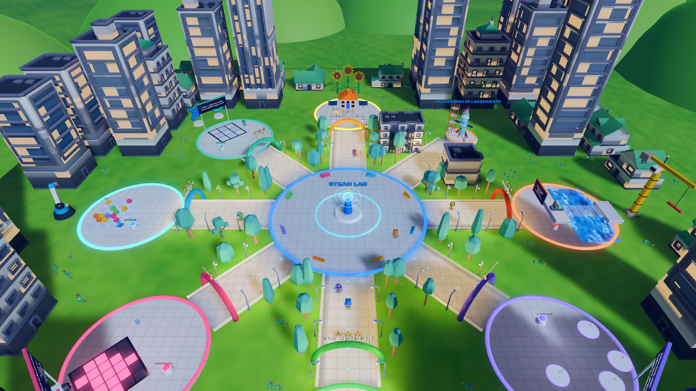
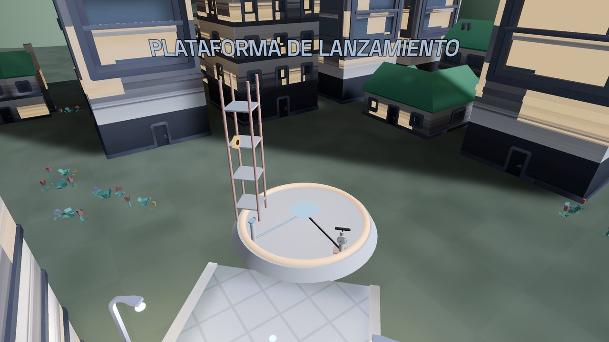
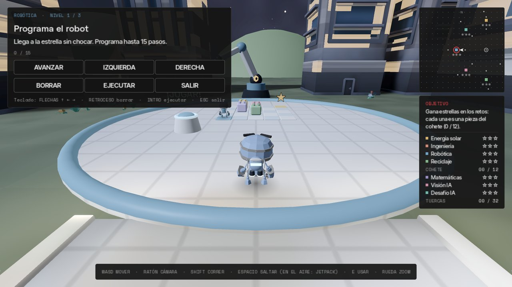
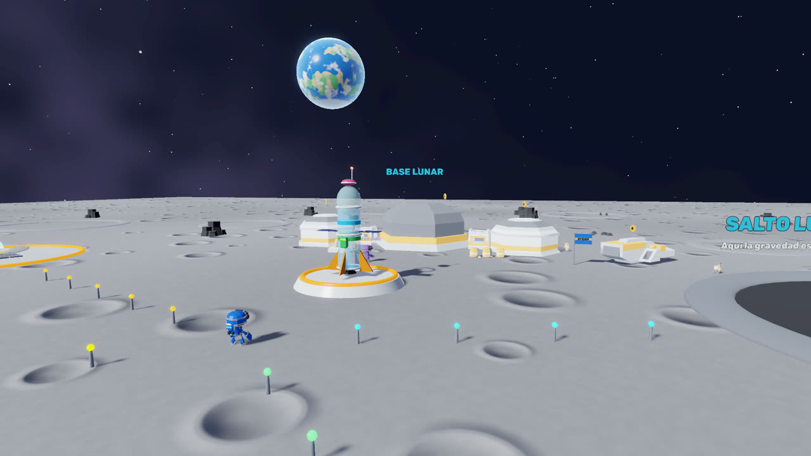

<div align="center">



# Ciudad STEAM

**Gana estrellas en retos de ciencia, tecnología, ingeniería, arte y matemáticas,<br>
arma un cohete de agua con ellas y viaja a la Luna.**


[**Descargar**](../../releases/latest) · [Los retos](#los-retos) · [Controles](#controles) · [Desde el código](#desde-el-código)

</div>

---

## La historia

Llegas a una ciudad de juguete, de noche y llena de luces, con un STEAM LAB holográfico en el centro. Cada reto
que superas te da hasta tres estrellas, y cada estrella es una **pieza de un cohete de agua**. Con las doce piezas,
llenas el cohete de agua, bombeas aire y despegas hacia la **Luna**. Allí no hay ríos ni lluvia, así que para
volver tendrás que encontrar hielo en los cráteres, dar energía a la base y purificar el agua.

## Los retos

| | Reto | Qué haces | Qué aprendes |
|:-:|---|---|---|
| ☀️ | **Energía solar** | Respondes preguntas y se van encendiendo las ventanas de la casa solar. | Paneles, corriente continua y alterna, potencia y energía. |
| 🌉 | **Ingeniería** | Construyes un puente de cinco tramos sin pasarte del presupuesto, y lo cruzan vehículos cada vez más pesados. | Resistencia, costo y por qué el centro carga más. |
| 🤖 | **Robótica** | Programas a un robot con «avanzar» y «girar» para que llegue a la estrella. | Algoritmos: instrucciones que se cumplen en orden. |
| ♻️ | **Reciclaje** | Recoges residuos y los lanzas a la caneca correcta. | El código de colores de Colombia: verde, blanca y negra. |
| ➗ | **Matemáticas** | Vuelas con el jetpack hasta la plataforma con la respuesta correcta. | Operaciones, porcentajes y áreas. |
| 👁️ | **Visión IA** | Dibujas pisando baldosas y una cámara con IA intenta reconocer la figura. | Para una computadora, una imagen es una cuadrícula de números. |
| ⭕ | **Desafío IA** | Juegas tres en raya contra NOVA, que en el último nivel usa minimax. | Cómo «piensa» una IA de juegos. |
| 🚀 | **Cohete de agua** | Lo llenas hasta un tercio, bombeas aire hasta la zona verde y despegas. | La tercera ley de Newton: acción y reacción. |

**En la Luna** (gravedad 1/6, ¡se salta muy alto!): subir un cráter en sombra perpetua para recoger hielo,
programar un rover entre rocas, girar cables para llevar la energía solar al fundidor y llenar un filtro de
grava, arena y carbón para purificar el agua.

**Además:** un jetpack (vuelve a saltar en el aire), 32 tuercas doradas escondidas que te dan un traje dorado,
un certificado STEAM al completar el cohete y otro de astronauta al volver de la Luna.

## Galería

<table>
  <tr>
    <td width="50%"></td>
    <td width="50%"></td>
  </tr>
  <tr>
    <td align="center"><sub>La plataforma del cohete de agua</sub></td>
    <td align="center"><sub>El reto de Robótica</sub></td>
  </tr>
  <tr>
    <td colspan="2"></td>
  </tr>
  <tr>
    <td colspan="2" align="center"><sub>La base lunar, con la Tierra en el cielo</sub></td>
  </tr>
</table>

## Controles

| Acción | Teclado y ratón | Mando |
|---|---|---|
| Moverse | `W` `A` `S` `D` o flechas | Stick izquierdo |
| Mover la cámara | Ratón | Stick derecho |
| Correr | `Shift` | `RB` o `L3` |
| Saltar / jetpack | `Espacio` (otra vez en el aire: jetpack) | `A` |
| Usar, recoger, jugar | `E` | `X` |
| Cerrar un panel | `Esc` | `B` o `Start` |
| Acercar o alejar la cámara | Rueda del ratón | — |

En Robótica también puedes programar con las flechas, `Retroceso` para borrar e `Intro` para ejecutar.

## Descargar y jugar

Descarga la última versión desde [**Releases**](../../releases/latest):

- **Windows:** `CiudadSTEAM-Windows.exe`. Es un solo archivo: ábrelo con doble clic. Si aparece «Windows
  protegió su PC», pulsa «Más información» y después «Ejecutar de todas formas».
- **Linux:** `CiudadSTEAM-Linux.zip`. Descomprímelo y ejecuta `./CiudadSTEAM.x86_64`; los dos archivos tienen
  que quedar en la misma carpeta.

Necesita una tarjeta gráfica con Vulkan. Va a más de 60 FPS en una gráfica integrada AMD Radeon 610M.

**Empezar de cero:** la partida se guarda sola. Para borrarla, elimina `save.cfg` de
`%APPDATA%\Godot\app_userdata\Ciudad STEAM\` en Windows o de `~/.local/share/godot/app_userdata/Ciudad STEAM/`
en Linux.

## Desde el código

Hace falta [Godot 4.7](https://godotengine.org/download). La primera vez tarda un poco, porque importa los modelos.

```bash
git clone https://github.com/xsteban1410/Godot-Game.git
godot --path Godot-Game/game
```

Pruebas automáticas (sin ventana):

```bash
godot --headless --path game --script res://tests/selfcheck.gd   # lógica de los retos
godot --headless --path game --script res://tests/play_test.gd   # partida completa: Tierra → Luna → Tierra
```

Para exportar, abre el proyecto en Godot y usa **Proyecto → Exportar** (ya están los ajustes de Windows y Linux).

### Estructura

```
game/
├── autoload/   estado global: estrellas, guardado, controles y sonidos sintetizados
├── core/       piezas comunes: mallas y materiales (Kit), robot animado, efectos y tuercas
├── models/     modelos 3D (Kenney, Quaternius) y sus créditos
├── modules/    un script por reto
├── player/     el jugador: movimiento, jetpack y cámara
├── tests/      pruebas automáticas
├── tools/      capturas, medición de FPS, y horneado de la ciudad
├── ui/         HUD, menú del STEAM LAB, tema y fuentes
└── world/      la ciudad, la Luna, sus sombreadores y los robots que pasean
```

## Créditos

- Basado en el juego de Unity «Ciudad STEAM», llevado a Godot y ampliado con la Misión Lunar.
- Modelos 3D de [Kenney](https://kenney.nl) y el robot animado de [Quaternius](https://quaternius.com), todos
  de dominio público (CC0).
- Fuentes Space Grotesk, Inter Tight, Space Mono, Doto e Inter, con licencia SIL Open Font License.

El detalle de cada recurso y su licencia está en [`game/models/CREDITS.md`](game/models/CREDITS.md).
